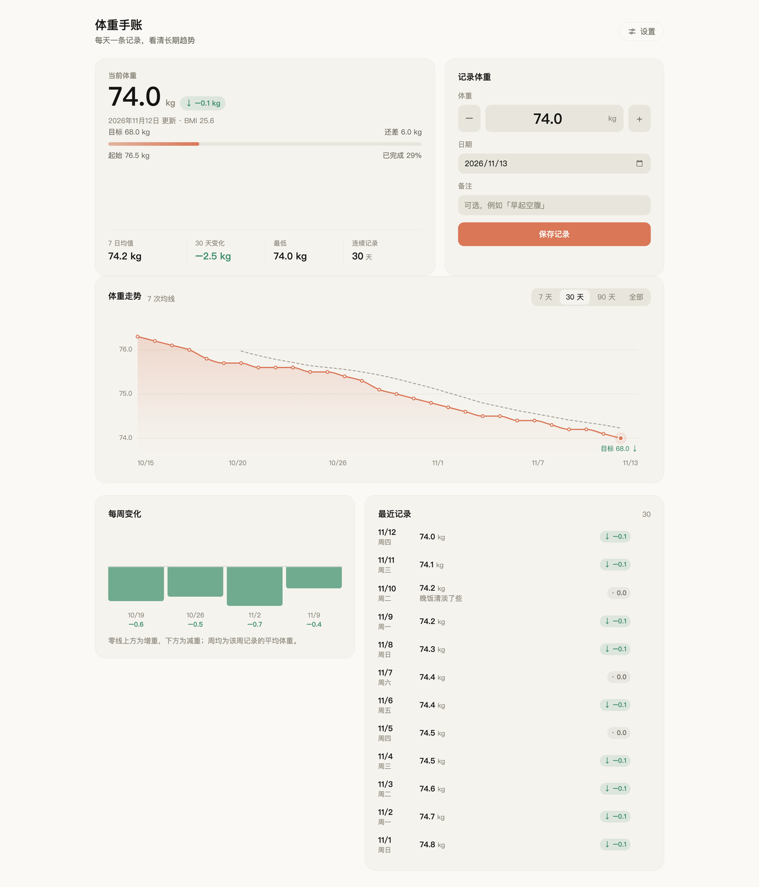

# dsh-weight-journal

A daily weight journal for the DeepSeek Harness Web GUI: one page, one reading a
day, one honest trend.

<picture>
  <source media="(prefers-color-scheme: dark)" srcset="docs/screenshot-dark.png">
  
</picture>

The page in the app's own theme, light and dark. The figures above are sample
readings, rendered from the plugin's shipped stylesheet rather than pasted from a
screenshot tool, so what ships is what is shown.

## Where it lives

A scale icon sits in the left sidebar's panel row (above Settings). It opens the
**Weight journal** main-panel page, beside Plugins and Schedules.

## The reminder capsule

While the app is open, a small capsule holds the centre of the conversation title
row — the strip that stays visible on every panel. Each language keeps it for
three beats before the next takes over, so one pass states the day, then the
change, then a tip:

1. **Today** — `今天 68.4 kg`, or `今天还没记录` before the day is saved.
2. **Change** — `比上次轻 0.3 kg · 继续保持`, `比上次重 1.2 kg · 需要加油`, or
   `和上次持平 · 稳住就好`. It compares with the last *recorded* reading, which is
   why it says 比上次 rather than 比昨天: after a gap it tells the truth about the
   gap instead of inventing the missing days.
3. **A tip** — eight per language (a lighter dinner, no overeating, less sugar, a
   walk after eating, an earlier night, water before the meal, a smaller portion,
   nothing before bed), stepping to the next one each pass so the same advice
   only comes round again after eight passes.

Eight languages in all, starting with the one the app is set to, one beat every
5.4 seconds — a language holds 16.2 seconds and the whole cycle is 2.16 minutes.
Clicking the capsule selects the journal, so the page has a second entrance.

It reads the journal before painting, so the state it shows is the stored one:
once the day is saved the trend mark turns accent and its end dot fills in, and
before that the mark keeps a slow waiting pulse. It registers into the frame's
`shell.overlay` seat, a whole-app layer that is click-through by default; the
capsule opts back into pointer events for its own 30-pixel row only. Being
centred, it stays clear of the session title on the left and the utilities on the
right until the window is narrow enough for the three to meet.

## What the page does

- **Record** — type today's weight (or use `−` / `+` in 0.1 steps), pick another
  day from the date field, add an optional note, and save. One reading per
  calendar day: saving a day that already exists replaces it.
- **Read the trend** — a monotone-cubic curve that never overshoots a reading,
  over a 7-day, 30-day, 90-day, or all-time window, with the entries' 7-reading
  mean, a dashed goal line, and a hover crosshair showing that day's weight and
  its change against the previous reading.
- **See the movement** — weekly mean weight compared with the previous week as a
  diverging bar chart, beside the recent entries.
- **Edit safely** — clicking a row loads it back into the form; deleting asks for
  an inline confirmation instead of acting on one click.
- **Personalise** — under Settings, a height adds BMI to the header and a goal
  weight adds the progress track.
- **Get back** — a *返回对话 / Back to conversation* breadcrumb above the page
  title returns to the Conversation, so leaving the page never requires finding
  it again in the sidebar.

## What the model can do

The same journal is reachable through the `weight_journal` tool (`record`,
`list`, `delete`). Both callers share one implementation, so a weight stated in a
conversation lands in the page the moment it refreshes.

## Where the data goes

`$DSH_HOME/storages/weight-journal.json`, written atomically. The plugin makes no
network request and reads nothing else. Disabling the plugin hides the page and
the tool; the file stays where it is.

## Layout of this bundle

| File | Role |
|---|---|
| `index.js` | Host half: the JSON store, two `ctx.connection.fetch` routes, the tool |
| `client.js` | Browser half: the page, the chart, the reminder capsule, the sidebar icon, the copy |
| `cordis.patch.yml` | Inserts the Host row |
| `locale/*.json` | Plugin Manager title, description, detail document |
| `docs/` | The detail document, its feature image, and the two screenshots |
| `icon.svg` | Plugin Manager icon |
| `assets/icon-180.png` | The square tile the plugin market shows |

## Install and update

From the registry, into a profile:

```sh
dsh plugin --profile web add dsh-weight-journal
```

Or from the Web GUI: **Plugins → Add plugin** and give the package name, a
`github:` spec, or a directory. The bundle is a plain package directory; when it
is installed from a directory DSH links it into the profile, so **where the
directory lives is part of the installation**.

- **Install from a checkout:** in the Web GUI open Plugins and use *Add plugin*
  to pick this directory, or call the `plugin_manager` tool with
  `action: install_bundle` and this absolute path.
- **Update:** edit the files here. The browser half is re-read from this
  directory, so a page refresh picks it up; a change to `index.js` (the Host
  half) needs the app restarted.
- **Move or rename the directory:** the profile holds an absolute `link:` path,
  so a move leaves a dangling link. Re-install as above, or run
  `plugin_manager` `remove_bundle` and then `install_bundle` with the new path.

## Notes on the UI

The page composes only from the host's `--dsw-alias-*` and `--dsw-radius-*`
theme tokens, so it follows light, dark, and every shipped theme without a local
palette. It imports no Harness Client package: React arrives from the browser
module table and every control is written here.

## License

MIT — see [LICENSE](LICENSE).

[](https://github.com/deepseek-ai/deepseek-harness)
