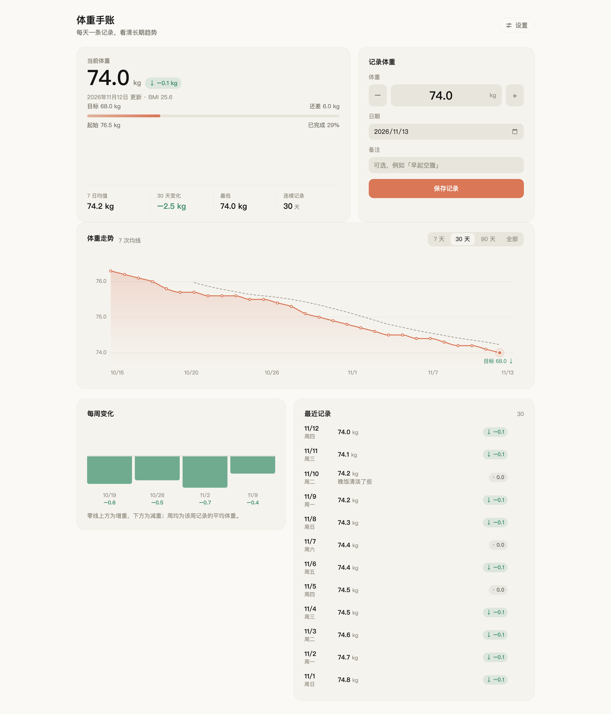

# dsh-weight-journal

[English](README.md) · **简体中文**

[](https://www.npmjs.com/package/dsh-weight-journal)
[](LICENSE)

给 DeepSeek Harness Web GUI 用的每日体重手账：一个页面，一天一条记录，一条不说谎的曲线。

<picture>
  <source media="(prefers-color-scheme: dark)" srcset="docs/screenshot-dark.png">
  
</picture>

上图是浅色与深色两套应用主题下的同一个页面。图中的数字是示例读数——它们直接用插件**实际发布的样式表**渲染出来，而不是用截图工具截的，所以图里看到的就是装上以后的样子。

## 特性

- **一天一条**：体重、日期、备注；同一天再保存会覆盖，不会长出两条。
- **趋势可信**：单调三次（monotone-cubic）曲线，永远不会因为插值而越过任何一个真实读数；支持 7 天 / 30 天 / 90 天 / 全部四个窗口。
- **两把参考尺**：最近 7 次读数的均值线，加一条虚线目标线；目标落在可视范围外时会变成一枚「目标 68.0 ↓」的越界标记，而不是悄悄消失。
- **周维度对比**：本周均值与上一周的均值作双向柱状对比，和最近记录并排。
- **提醒胶囊**：应用常驻顶栏中央的一枚小胶囊，八种语言轮播今天、变化、提醒。见[下文](#提醒胶囊)。
- **模型也能记**：`weight_journal` 工具（`record` / `list` / `delete`）与页面共用同一套实现，对话里报一个体重，页面刷新即可见。
- **只吃主题变量**：只用宿主的 `--dsw-alias-*` / `--dsw-radius-*` 主题变量，因此浅色、深色和任何第三方皮肤都自动适配，插件本身不含任何写死的颜色。

## 它住在哪里

左侧边栏的面板列表里多一个体重计图标（在「设置」之上），点开就是**体重手账**主面板，和「插件」「定时任务」并列。

页面标题上方有一枚 *‹ 返回对话* 面包屑，一步回到对话，不用再去边栏里翻。

## 提醒胶囊

应用开着的时候，对话标题行（在每一个面板都常驻的那条顶栏）正中间会挂一枚小胶囊——除非你把它拖到别处。每种语言连续占用三次节拍，所以一轮下来依次是今天、变化、一条提醒：

1. **今天** —— `今天 68.4 kg`；当天还没记时是 `今天还没记录`。
2. **变化** —— `比上次轻 0.3 kg · 继续保持`、`比上次重 1.2 kg · 需要加油`，或 `和上次持平 · 稳住就好`。它比的是**上一条有记录的读数**，所以文案写的是「比上次」而不是「比昨天」：中间断了几天，它照实说断了，而不是替你虚构那几天。
3. **一条提醒** —— 每种语言八条（晚饭清淡、别暴饮暴食、少喝含糖饮料、饭后走一走、早点睡、饭前先喝杯水、主食减一点、睡前别加餐），每轮往下走一条，所以同一句劝告要过八轮才会再出现。

一共八种语言，从应用当前的语言开始；每 5.4 秒换一拍，一种语言停 16.2 秒，整轮 2.16 分钟。点胶囊会切到手账页面，等于多了一个入口。

### 挪开它

有些主题会在同一条顶栏里画出自己的控件，胶囊压在上面比没有更糟。直接拖走就行：位置按窗口比例保存，缩放窗口、重启应用都不会跑回中间；想让它回家，「个人设置」里有「回到中间」。不用鼠标时方向键每次挪 8 像素，按住 Shift 是 24 像素；按下后走出 3 像素才算拖动，松手那一下不会误触打开页面。

它在绘制之前先读一次记录，所以显示的就是存下来的状态：当天保存之后，胶囊里的趋势图标会变成强调色、末端圆点变实心；在那之前图标保持一个缓慢的等待脉冲。它注册在框架的 `shell.overlay` 座位上——那是覆盖整个应用、默认点击穿透的一层；胶囊只在自己那 30 像素高的一行里重新接收指针事件。因为居中，它会自动躲开左边的会话标题和右边的工具按钮，直到窗口窄到三者真的相遇。

## 页面能做什么

- **记录** —— 输入今天的体重（也可以用 `−` / `+` 按 0.1 步进），用日期框补记别的日子，写一句可选备注，保存。一个日历日只留一条。
- **看趋势** —— 7 / 30 / 90 天与全部窗口的曲线，附最近 7 次读数的均值、虚线目标线；悬停有十字准星，显示当天的体重，以及相对上一次读数的变化。
- **看周对比** —— 本周均值对上一周，双向柱状图，和最近记录放在同一行。
- **改得安全** —— 点一行会把它载回表单；删除是行内的二次确认，不会一点就没了。
- **个性化** —— 「设置」里填身高，页头多出 BMI；填目标体重，多出目标进度条。
- **回得去** —— 标题上方的 *‹ 返回对话* 面包屑。

## 模型能做什么

同一本手账也通过 `weight_journal` 工具开放（`record`、`list`、`delete`）。两个调用方共用同一套实现，所以对话里说一个体重，页面上刷新就是新的。

## 数据存在哪里

`$DSH_HOME/storages/weight-journal.json`，原子写入（先写临时文件再改名）。插件不发任何网络请求，也不读别的文件。停用插件只会隐藏页面和工具，文件原地保留；重新启用，记录还在。

## 这个 bundle 的结构

| 文件 | 作用 |
|---|---|
| `index.js` | 宿主侧：JSON 存储、两条 `ctx.connection.fetch` 路由、`weight_journal` 工具 |
| `client.js` | 浏览器侧：页面、图表、提醒胶囊、边栏图标、中英文案 |
| `cordis.patch.yml` | 插入宿主那一行 |
| `locale/*.json` | 插件管理里的名称、简介与详情文档 |
| `docs/` | 详情文档、特性图，以及上面两张截图 |
| `icon.svg` | 插件管理里的图标 |
| `assets/icon-180.png` | 插件市场里显示的方形图块 |

## 安装与更新

从 registry 装进一个 profile：

```sh
dsh plugin --profile web add dsh-weight-journal
```

也可以走 Web GUI：**插件 → 添加插件**，填包名、`github:` 规格，或直接给一个目录。这个 bundle 就是一个普通的包目录；从目录安装时 DSH 会把它以软链方式接进 profile，所以**目录放在哪里，本身就是这次安装的一部分**。

- **从本地检出安装**：在 Web GUI 的插件页用「添加插件」选中本目录，或调用 `plugin_manager` 工具，`action: install_bundle`，参数用这个绝对路径。
- **更新**：直接改这里的文件。浏览器侧会从这个目录重新读取，刷新页面即可生效；改 `index.js`（宿主侧）需要重启应用。
- **移动或改名目录**：profile 里存的是绝对 `link:` 路径，移动会留下断链。按上面的方式重装，或先 `remove_bundle` 再用新路径 `install_bundle`。

## 关于 UI

页面只由宿主的 `--dsw-alias-*` 与 `--dsw-radius-*` 主题变量拼成，跟随浅色、深色和任何随应用发布的主题，不含自己的调色板。它不引入任何 Harness Client 包：React 来自浏览器的模块表，每个控件都写在这个文件里。

更细的说明见[详情文档](docs/DETAIL.zh.md)。

## 许可

MIT —— 见 [LICENSE](LICENSE)。

[](https://github.com/deepseek-ai/deepseek-harness)
